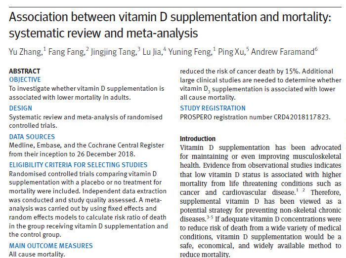
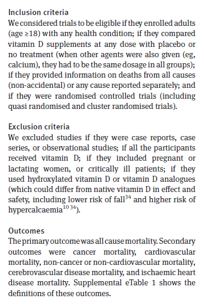
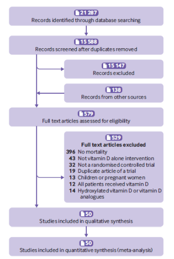
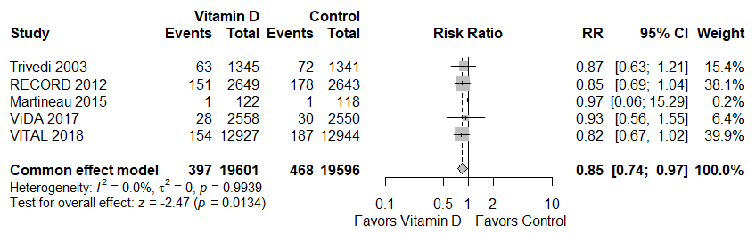
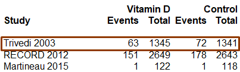
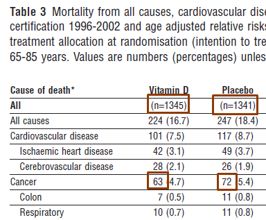
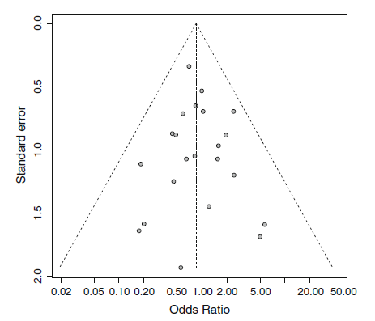
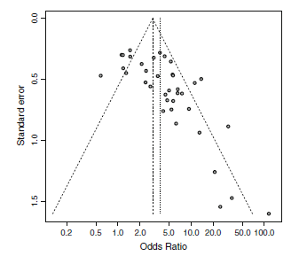
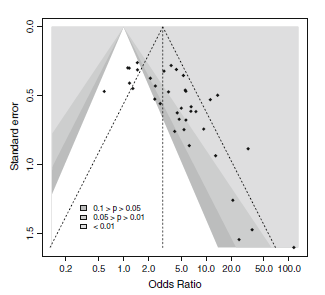
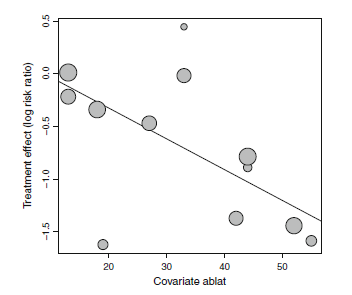

## What is Meta-Analysis?

A study about studies.

Refers to the analysis of analyses. (Glass, 1976)

A systematic literature review that uses statistics to **combine results** and achieve greater generalizability of findings than any single study. (Hothorn and Everitt, 2014)

An attempt to **pool the results** of individual studies into a single analysis with the intention to produce a message where before there was none, or to make the message clearer, or to resolve an apparent contradiction in messages, or to assess whether the message changes from subgroup to subgroup. (Senn, 2007)

<!-- Sometimes called _Cochrane Reviews_, due to the [Cochrane Library](https://www.cochranelibrary.com/) that maintains a collection of systematic reviews. -->

## Example of a Meta-Analysis



## Study selection

The most important and hardest part of a meta-analysis is study selection. Requires exclusion and inclusion criteria, which requires judgment.

 

## Meta-Analysis results

Forest plot of cancer mortality. "Vitamin D supplementation was associated with a reduced risk of cancer mortality by 15%."



## Example of study data

The first row in the forest plot on the previous slide showed the following: 

This data came from Table 3 of Trivedi (2003):



## Effect Measures

Meta-analysis usually looks at studies comparing two interventions: *experimental* and *control*. Outcomes are typically *continuous* or *binary*.

**Continuous** examples:

- Mean difference
- Standardized mean difference
- Hazard ratio

**Binary** examples:

- Odds ratio
- Risk ratio
- Risk difference

## Example of Continuous Data

Studies investigating the effect of mental health treatment (psychotherapy versus control). Outcome is the number of days in hospital. (Fleiss, 1993) Statistical summary is difference in means.

```{r echo=FALSE, message=FALSE}
library(meta)
data(Fleiss1993cont)
Fleiss1993cont
```

## Example of Binary Data

Studies investigating the effect of Vitamin D supplement on reducing risk of cancer mortality (Vitamin D versus control). Outcome is mortality (yes/no). (Zhang et al. 2019) Statistical summary is risk ratio.

```{r echo=FALSE}
vitamin <- data.frame(study = c("Trivedi 2013", "RECORD 2012", 
                                "Martineau 2015",
                                "ViDA 2017", "VITAL 2018"),
                      vd_events = c(63, 151, 1, 28, 154),
                      vd_total = c(1345, 2649, 122, 2558, 12927),
                      ctrl_events = c(72, 178, 1, 30, 187),
                      ctrl_total = c(1341, 2643, 118, 2550, 12944))
vitamin
```

## Performing Meta-Analysis in R

In this workshop we'll use the meta package. (Balduzzi et al. 2019)

- Use `metacont()` function for continuous data.
- Use `metabin()` function for binary data.

Example for mental health treatment data:

```{r eval=FALSE}
ma <- metacont(n.e = n.psyc, mean.e = mean.psyc, sd.e = sd.psyc,
               n.c = n.cont, mean.c = mean.cont, sd.c = sd.cont,
               data = Fleiss1993cont, studlab = paste(study, year),
               sm = "MD")  # summary measure: mean difference
summary(ma)
forest(ma) # create forest plot
```

Example for vitamin D data:

```{r eval=FALSE}
ma <- metabin(event.e = vd_events, n.e = vd_total,
              event.c = ctrl_events, n.c = ctrl_total,
              data = vitamin, studlab = study,
              sm = "RR")  # summary measure: risk ratio
summary(ma)
forest(ma) # create forest plot
```

## Meta-analysis models

Two methods for combining study results:

1.  **Fixed-effect model**: Also called the "Common effect model". Assumes studies are estimating a true single effect size. Assumes studies come from a single *homogeneous* population.

2.  **Random-effect model**: Assumes study results are sampled from a distribution of effects. Assume studies come from a *heterogeneous* population. Estimates variance between studies as $\tau^2$.

By default, the meta package functions return both estimates.

## Measures of heterogeneity

```         
Quantifying heterogeneity (with 95%-CIs):
 tau^2 = 0.0564 [0.0000; 11.5467]; tau = 0.2376 [0.0000; 3.3980]
 I^2 = 25.1% [0.0%; 71.1%]; H = 1.16 [1.00; 1.86]

Test of heterogeneity:
    Q d.f. p-value
 4.00    3  0.2611
```
- Null of heterogeneity test: studies come from a single homogeneous population.
- $Q$: weighted sum of squared differences between study means and fixed effect estimate.
- $\tau^2$: estimate of variance between studies.
- $I^2$: percentage of variability in treatment estimate attributable to heterogeneity between studies rather than to sampling error. 0 implies no heterogeneity. Bonett (2021) does not recommend reporting. 
- $H$: describes the relative difference between the observed $Q$ and its expected value in the absence of heterogeneity. Bigger $H$ means more heterogeneity. 1 implies no heterogeneity.


## Which model to choose?

- Can always report both.
- Or use heterogeneity measures to justify one over the other.
- "A number of authors have argued that, as small studies are more susceptible to bias, the fixed effect estimate is (almost) always preferable." (Schwarzer et al, 2015, page 34)
- "in most meta-analyses...heterogeneity can almost be assumed to be present." (Hothorn and Everitt, 2014, page 322)

Let's go to R!

## Publication bias

A potential problem with meta-analysis is *publication bias*. Also called *small study effects*.

- "Statistically significant" research more likely to be published than research that fails to achieve significance.
- When assessing multiple outcomes, sometimes researchers only present "significant" results while ignoring non-significant results.
- Smaller studies more likely to get published if they show large effect.
- Smaller studies more likely to get filed away if they show no effect.

All this can lead to over-representation of positive results.

## Funnel plots

A funnel plot is an informal method of assessing publication bias. Plot precision of study versus the summary measure.

If there is no publication bias, smaller studies should be more widely dispersed around the pooled summary measure and the plot should be roughly in the shape of a funnel or triangle.

If the plot is *asymmetric*, this could be a sign of publication bias.

Easy to create using the meta package: `funnel()`

## No evidence of publication bias



## Possible evidence of publication bias



## Other sources of asymmetry

Sterne et al (2011) caution against assuming asymmetry in a funnel plot means publication bias. Other sources of asymmetry:

- Poor methodological design of certain studies
- True heterogeneity (eg, types of participants, different locations)
- Inadequate analysis
- Confounding and precision of measurements
- Fraud
- Chance

## Contour-Enhanced Funnel Plot

Contour-enhanced funnel plots may help differentiate between publication bias and other reasons.

Contour lines representing statistical significance are added to a funnel plot to indicate regions where a test of treatment effect is significant.

If many or all of the smaller studies exhibit significance while some of the larger studies do not, there is more evidence of publication bias.

## Contour-Enhanced Funnel Plot



## Tests for asymmetry

There are many tests available to examine whether asymmetry exists in a funnel plot. They are deployed with the `metabias()` function. Rule of thumb: don't use if you have fewer than 10 studies. (Sterne et al, 2011)

Null hypothesis: no association between effect size and precision.

Use the `method.bias` argument to specify the type of test.

**Generic tests**: `"Begg"`, `"Egger"`, or `"Thompson"`\
**Modified tests for binary outcomes**: `"Harbord"`, `"Macaskill"`, `"Peters"`, or `"Schwarzer"`

Example: `metabias(ma1, method.bias = "Egger")`

See `help(metabias)` for details on the tests.

Let's go to R!

## Subgroup analysis

Sometimes it's of interest to compare subgroups of studies in a meta-analysis.

For example, in the Vitamin D meta-analysis a subgroup analysis was performed to compare type of vitamin (D~3~ versus D~2~).

Sometimes subgroup analyses can untangle heterogeneity present in the overall meta-analysis.

You need more studies to carry out a subgroup analysis. Schwarzer et al (2015) say, "it does not make sense...to investigate two or more factors if there are less than ten studies in a meta-analysis."

## Subgroup analysis implementation

To implement a subgroup analysis using the meta package, use the `subgroup` argument with the variable that indicates group membership.

Example where duration indicates \<= 3 months versus \>3 months

```{r eval = FALSE}
ma <- metacont(Ne, Me, Se, Nc, Mc, Sc, data = d,
               studlab = study,
               subgroup = duration)

```

The summary and forest plot will break out the studies by group and present a test for subgroup differences. Null: no difference between groups.

## Meta-regression

Meta-regression is basically subgroup analysis with a numeric variable as opposed to a categorical variable.

The meta package provides the `metareg()` function, which is wrapper for the `rma.uni()` function in the metafor package.

Typical usage:

```{r eval=FALSE}
ma <- metabin(tpos, tpos + tneg, cpos, cpos + cneg,
              data = d, 
              studlab = study)
ma.mr <- metareg(ma, ~ var)
```

Returns regression output with a slope coefficient and a test to assess if the coefficient is reliably different from 0.

## Bubble plot

We can create a bubble plot to visualize meta-regression using the `bubble()` function.



Let's go to R one last time!

## Wrap-up

This workshop covered meta-analysis basics. For a deeper dive, I recommend the following books:

- Meta-Analysis with R, Schwarzer et al. 2015 (Free access through UVA)
- [Doing Meta-Analysis in R: A Hands-on Guide](https://doing-meta.guide/), Harrer et al. 2021 (open access)

These books go into advanced topics such as Network Meta-Analysis, Structural Equation Modeling Meta-Analysis, and Multivariate Meta-Analysis.

See also the PRISMA (Preferred Reporting Items for Systematic reviews and Meta-Analyses) [Checklist](https://www.prisma-statement.org/)

## Thanks for coming

- For free statistical consulting, contact us: `statlab@virginia.edu`

- Sign up for more workshops or see past workshops:\
  <https://library.virginia.edu/data/training>

- Register for the Research Data Services newsletter to be notified of new workshops:\
  <https://library.virginia.edu/data/newsletters>

## References

::: {style="font-size: 60%;"}
- Balduzzi S, Rücker G, Schwarzer G (2019). How to perform a meta-analysis with R: a practical tutorial, *Evidence-Based Mental Health*; 22: 153-160.

- Bonnet DG (2021). Introduction to Meta-analysis. <https://dgbonett.sites.ucsc.edu/statistical-methods-for-psychologists/>

- Chalmers T and Lau J. (1993). “Meta-Analytic Stimulus for Changes in Clinical Trials.” Statistical Methods in Medical Research 2 (2): 161–72. <https://doi.org/10.1177/096228029300200204>.

- Fleiss J. (1993). “Review Papers: The Statistical Basis of Meta-Analysis.” *Statistical Methods in Medical Research* 2 (2): 121–45. <https://doi.org/10.1177/096228029300200202>.

- Glass, G. V. (1976). Primary, Secondary, and Meta-Analysis of Research. Educational Researcher, 5(10), 3–8. <https://doi.org/10.2307/1174772>

- Harrer M, Cuijpers P, Furukawa TA, & Ebert DD (2021). *Doing Meta-Analysis with R: A Hands-On Guide*. Boca Raton, FL and London: Chapman & Hall/CRC Press. ISBN 978-0-367-61007-4. <https://doing-meta.guide/>

- Hothorn T, Everitt BS (2014). *HSAUR3: A Handbook of Statistical Analyses Using R (3rd Edition)*. doi:10.32614/CRAN.package.HSAUR3 <https://doi.org/10.32614/CRAN.package.HSAUR3>. R package version 1.0-15, <https://CRAN.R-project.org/package=HSAUR3>.

- Schwarzer G, et al. (2015). *Meta-Analysis with R*. Springer.

- Sterne JAC, Sutton AJ, Ioannidis JPA, et al. (2011). “Recommendations for Examining and Interpreting Funnel Plot Asymmetry in Meta-Analyses of Randomised Controlled Trials.” BMJ 343 (jul22 1): d4002–d4002. <https://doi.org/10.1136/bmj.d4002>.

- Trivedi DP, Doll R, Khaw KT. (2003) Effect of four monthly oral vitamin D3 (cholecalciferol) supplementation on fractures and mortality in men and women living in the community: randomised double blind controlled trial. BMJ. Mar 1;326(7387):469. doi: 10.1136/bmj.326.7387.469. PMID: 12609940; PMCID: PMC150177.

- Zhang, Yu, Fang Fang, Jingjing Tang, et al. (2019). "Association between Vitamin D Supplementation and Mortality: Systematic Review and Meta-Analysis." BMJ, August 12, l4673. <https://doi.org/10.1136/bmj.l4673>.
:::
